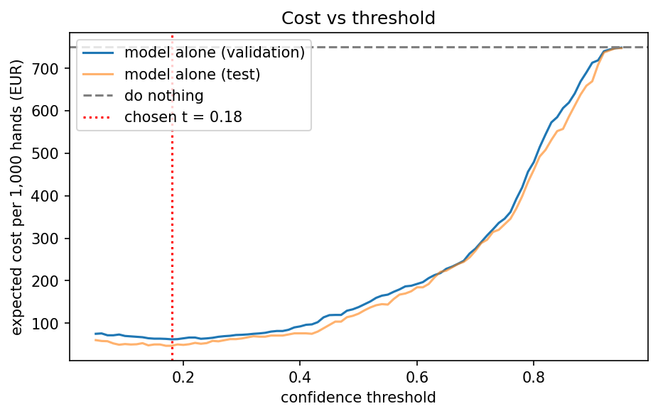

# Assignment 2 Report

- **Name**: Alexia Lara Chacon
- **Student ID**: 18964
- **Email**: alara.ieu2022@student.ie.edu
- **Group**: BBADBA 5B

## Business problem
The decision is whether a hand of bananas is shipped to a customer.
- At a banana packing station, a camera photographs each hand on the line and the model gives it a "rotten" score.
- Below a low threshold (0.10) the hand passes and goes into the carton.
- Between 0.10 and 0.52 it goes to a person at a review station, who looks at it for about 10 seconds and decides.
- From 0.52 up it fails automatically: the hand is pulled off the line and sold cheaper. The station handles about 10,000 hands a day.

**Cost of a miss (a rotten hand reaches a customer): €25.** 
I chose this because it is roughly the wholesale price of a carton of bananas (about €19 to €29 in market reports), and a customer who finds a rotten hand can return the carton or be credited for it. I chose it because it seemed realistic for a real packing station.

**Cost of a false alarm (a good hand is wrongly failed): €0.50.** 
A failed good hand is not thrown away, it is sold cheaper, so only part of its value is lost. 

I think that a customer receiving a rotten hand is much worse than a good one being labeled rotten, which is why its more costly than a false alarm. 

**Which mistake is worse.** 
A miss is much worse than a false alarm, because a customer receiving a rotten banana is much more harmed than a good banana being sold cheaper. It costs about 50 times more (€25 against €0.50). Because of this, it pays to flag a hand even when the model is only a little suspicious, so the best threshold is low: the sweep found about 0.18, not the usual 0.5. At 0.5 the cost would be about €138 per 1,000 hands instead of about €47.

**Why only rotten is "bad".** 
An overripe banana can still be sold, to people who bake or who like very ripe bananas, while a rotten one cannot be sold or recovered. So only rotten counts as a failure.

**Why one image is one case.**
- A photo can contain several bananas with different labels, and one banana can carry two overlapping labels, so counting boxes gives no clean "true negative". Treating an image as a case keeps the confusion matrix well defined.

## Dataset
- **Roboflow Universe:** workspace `fruit-ripening`, project `banana-ripening-process`, **version 2** (CC BY 4.0). Link: https://universe.roboflow.com/fruit-ripening/banana-ripening-process/dataset/2
- **Task:** object detection.
- **6 Classes:** freshripe, freshunripe, overripe, ripe, rotten, unripe.
- One image is a photo of one or several bananas, each box labelled with a ripeness stage.

It fits the problem because it has a rotten class alongside the other ripeness stages, so a rotten / not rotten decision can be built from it, and every class has at least 156 test instances, enough to evaluate each one. It does not fully resemble a real line.

## What the dataset's composition implies

7,546 original images. Version 2 has 18,074 because Roboflow made 3x augmented copies of the **training split only**. The real split is about 5,264 / 1,525 / 757 original images (train / valid / test).

| Class | Train instances (incl. augmented copies) | Valid instances | Test instances | Test images containing it | Median box size in test (% of image) |
|---|---|---|---|---|---|
| freshripe | 3,105 | 315 | 156 | 130 | 41% |
| freshunripe | 4,086 | 417 | 212 | 99 | 14% |
| overripe | 4,326 | 438 | 178 | 145 | 53% |
| ripe | 7,167 | 654 | 351 | 205 | 23% |
| rotten | 8,676 | 780 | 448 | 288 | 14% |
| unripe | 4,197 | 408 | 174 | 77 | 16% |

No class is very small: the smallest has 156 test instances. But my costing depends on rotten, and there are only 288 rotten test images, so at my chosen threshold the model missed just 10 of them. A change of one or two misses moves the cost noticeably (the same band costs €45 per 1,000 hands on validation and €31 on test), so the euro figures are noisy.

The test split does not resemble a real line. Rotten is in 38% of test images, but I assumed 3% in real life. The backgrounds are mostly plain, most images show a single banana (447 of 757 have one box), and some test images are rotated copies with black corners. I therefore cannot conclude how the model would perform on a real, messier line, or what the true share of rotten hands is.

## Finetuning and baselines

- **Model:** yolo11n, object detection, finetuned from the COCO-pretrained checkpoint on Google Colab (T4 GPU), 20 epochs, 416 px, batch 32, seed 0, Ultralytics default augmentation.
- **Why detection:** one photo can contain several bananas at different ripeness stages, and the dataset is labelled with boxes. Classification gives one label per photo, which would hide that. Detection gives a rotten confidence for each banana, and I take the highest one per image.
- **Provenance:** the submitted weights and the numbers below come from an earlier notebook run with the same settings as `train.py`, not from `train.py` itself. ( I trained it in google colab not in github, but train.py has the same steps).

Results on the **test split**:

| Model | mAP50 | mAP50-95 | Cost per 1,000 hands, image level |
|---|---|---|---|
| Finetuned yolo11n | 0.946 | 0.700 | €46.72 (alone, threshold 0.18) |
| COCO pretrained, zero-shot | 0 on the six classes (it has no ripeness classes; by construction, not measured) | 0 | about €499 to €584 (flag an image if COCO sees a banana) |
| Predict nothing / majority class | 0 | 0 | €750 (same as doing nothing) |

The pretrained COCO model only knows "banana", not ripeness. It sees a banana in 93% of test images, so flagging "banana" flags almost everything: at confidence 0.25 it catches 92% of the rotten images but also falsely flags 93% of the good ones. My model, at threshold 0.18, catches 96.5% of the rotten images and falsely flags only 4.3% of the good ones. So the improvement is not "detecting more images", it is telling rotten from not rotten.

- The gap is larger than I expected: I thought a general model would at least partly separate rotten from good, but it cannot.
I imagine its because the COCO model has no ripeness information, so it could only flag everything.

## Per-class evaluation and failure modes

| Class | Precision | Recall | AP50 | AP50-95 |
|---|---|---|---|---|
| freshripe | 0.844 | 0.903 | 0.956 | 0.779 |
| freshunripe | 0.863 | 0.910 | 0.952 | 0.739 |
| overripe | 0.926 | 0.938 | 0.980 | 0.815 |
| ripe | 0.837 | 0.895 | 0.935 | 0.662 |
| **rotten** (positive) | 0.886 | **0.833** | 0.915 | **0.563** |
| unripe | 0.871 | 0.889 | 0.936 | 0.642 |
| **all** | 0.871 | 0.895 | 0.946 | 0.700 |

Confusion matrix on the test split at confidence 0.25 (computed from the stored predictions, boxes matched at IoU 0.45; **rows = predicted, columns = true**; the "background" column holds false-positive boxes and the "background" row holds missed true boxes):

| pred \ true | freshripe | freshunripe | overripe | ripe | rotten | unripe | background |
|---|---|---|---|---|---|---|---|
| freshripe | 141 | 0 | 0 | 7 | 0 | 0 | 29 |
| freshunripe | 0 | 201 | 0 | 0 | 0 | 6 | 40 |
| overripe | 0 | 0 | 167 | 11 | 2 | 0 | 7 |
| ripe | 11 | 0 | 6 | 324 | 1 | 0 | 86 |
| rotten | 0 | 0 | 5 | 0 | 399 | 1 | 60 |
| unripe | 0 | 0 | 0 | 0 | 2 | 156 | 27 |
| background | 4 | 11 | 0 | 9 | 44 | 11 | 0 |

Overripe is the strongest class (recall 0.938, AP50-95 0.815). 
**Rotten is the weakest** on the measure that matters (recall 0.833, AP50-95 0.563), even though it is the largest class, so its weakness is not about too little data. Its class mix-ups are rare (399 of its boxes are matched correctly), but the model **misses 44 rotten boxes entirely** (the most of any class) and puts 60 rotten boxes where there is none. 
- The gap between its AP50 (0.915) and AP50-95 (0.563) suggests the model finds rotten fruit but draws the box differently from the labels, which fits what I saw in the data: rotten boxes are sometimes a small dark patch and sometimes the whole banana. Mix-ups between classes are mostly between neighbouring ripeness stages (ripe / freshripe, ripe / overripe, unripe / freshunripe).

## Cost matrix and operating point

| Assumption | Value | Why |
|---|---|---|
| Cost of a miss | €25 | About the wholesale price of a carton (€19 to €29), credited to the customer |
| Cost of a false alarm | €0.50 | A failed good hand is sold cheaper, so only part of its value is lost |
| Base rate (rotten share of hands) | 3% | A middle assumption for a typical line; I also tested 0.5% to 10% |
| Hands per day | 10,000 | One hand about every 3 seconds over an 8-hour shift |
| Seconds per human check | 10 s | Seemed reasonable for a real inspection job |
| Labour cost | €26.4 per hour | Eurostat 2025 average for Spain, including employer costs; a packing worker is probably cheaper |
| Reviewer catch rate | 95% | High without being unrealistically perfect like 99% |
| Reviewer false-fail rate | 1% | A working assumption: a careful reviewer rarely rejects a good hand, and it costs only €0.50 when they do, so it barely changes the result |
| Person checking every hand | 10 s each, catches 95%, wrongly fails 1% | Same careful check as the reviewer, so the comparison is fair |

Carton price reference: market reports put an 18.14 kg carton at roughly €19 to €29 wholesale (CropGPT and FreshPlaza summaries).

**Sweep:** thresholds from 0.05 to 0.95, chosen on the validation split and reported on the test split. The single-threshold cost is lowest at **0.18** (about €62 per 1,000 hands on validation) and almost flat from 0.10 to 0.25 (€62 to €70). On test, 0.18 costs €46.72 per 1,000 hands (TP 278, FP 20, FN 10, TN 449).

**Sensitivity (model alone, best threshold re-found each time).** The model beat "do nothing" in every case I tested.

| Base rate | 0.5% | 1% | 3% | 5% | 10% |
|---|---|---|---|---|---|
| Best threshold | 0.37 | 0.31 | 0.18 | 0.15 | 0.05 |

| Cost of a miss | €1 | €2 | €5 | €10 | €25 | €50 | €100 |
|---|---|---|---|---|---|---|---|
| Best threshold | 0.56 | 0.47 | 0.31 | 0.25 | 0.18 | 0.15 | 0.05 |

**The assumption that would most change my answer**
- The base rate. If rotten hands were only 0.5% of the line the best threshold would be 0.37, and at 10% it would be 0.05. I am least sure of it, because the dataset is 38% rotten and I have no real line data.

## What a person still has to check

**Design:** pass below **0.10**, send to a person from 0.10 up to 0.52, fail from **0.52**. The upper edge was chosen on validation. I chose the lower edge of 0.10 myself.

| Strategy (test split) | Cost per 1,000 hands | Cost per day | People checking |
|---|---|---|---|
| Do nothing (ship everything) | €750 | €7,500 | 0 |
| A person checks every hand | €116 | €1,157 | about 4 |
| Model alone (threshold 0.18) | €47 | €467 | 0 |
| **Model + human review** | **€31** | **€308** | **0.26** |

**Review load:** 6.7% of hands = **667 hands per day**, about one every 43 seconds, at 10 s each. That is about 1.85 hours of checking a day (a quarter of an 8-hour shift), or 0.26 of a full-time person. On the test images, of 288 rotten, 6 pass, 45 go to review and 237 fail; of 469 good, 435 pass, 30 go to review and 4 fail.

**Why a lower edge of 0.10** 
- Moving it from 0.05 to 0.10 costs only about €2.7 more per 1,000 hands (€28.2 to €30.8) but cuts the review work from 959 to 667 hands a day, so it is a good trade.

| Lower threshold | Cost per 1,000 | Hands to a person per day | People |
|---|---|---|---|
| 0.05 | €28.2 | 959 | 0.38 |
| 0.10 (chosen) | €30.8 | 667 | 0.26 |
| 0.20 | €42.9 | 309 | 0.12 |

**Is it realistic?** Yes. It is less than a full-time job, so no extra hire is needed, but a flagged hand arrives about every 43 seconds, so someone has to be at the station all shift.

**Comparison.** 
Model + review costs about 96% less than doing nothing, about 73% less than having a person check every hand (while a person looks at only 6.7% of the hands instead of all of them), and about 34% less than letting the model decide alone. It only beats the model alone if reviewers catch more than about 81% of the rotten hands they see: at 70% it would cost €60 per 1,000, worse than the model alone at €47.

## Limitations & next steps
- **The base rate.** The dataset is 38% rotten but I assumed 3%, so every euro figure rests on that assumption. A next step could be - measure the real share of rotten hands on the line for a few weeks.
- **Few rotten test images.** There are only 288, with 10 misses at my chosen threshold, so costs are noisy (€45 on validation against €31 on test). Next step: collect more test photos and report the spread.
- **Assumed human numbers.** The reviewer's 95% catch rate, 1% false-fail rate, 10 seconds and 7 productive hours are assumptions. Next step: time and test real reviewers.
- **Inconsistent rotten labels.** Rotten boxes are sometimes a small patch and sometimes the whole banana, and some bananas carry two overlapping labels. Next step: relabel with one clear rule and retrain.
- **A tidier dataset than a real line.** Mostly plain backgrounds and some rotated copies in the test split. Next step: photograph hands on the real line under its lighting.

## Generative AI use disclosure

I used Claude for help. It helped me decide on a topic as I was between this one and one about hats but it mentioned this was probably better. It helped me edit my training and evaluation. It helped me do most of the Gradio dashboard code and explained concepts to me like the mAP and confusion matrices. 
 It also searched for reference figures (Eurostat labour cost, wholesale banana prices) and, where I did not know a value, offered example options for several assumptions (cost of a miss, cost of a false alarm, base rate, hands per day, check time, reviewer accuracy) from which I chose. I asked this to ensure that the assumptions I made actually made sense. 
 For this report, Claude formatted my results tables, suggested wording for some of the interpretation, and gave me options to choose between for parts I was unsure. The decisions were mine: the problem and setting, rotten as the only bad class, one image as one case, and the euro figures and thresholds. The submitted weights and numbers come from an earlier notebook run with the same settings as `train.py`. 
